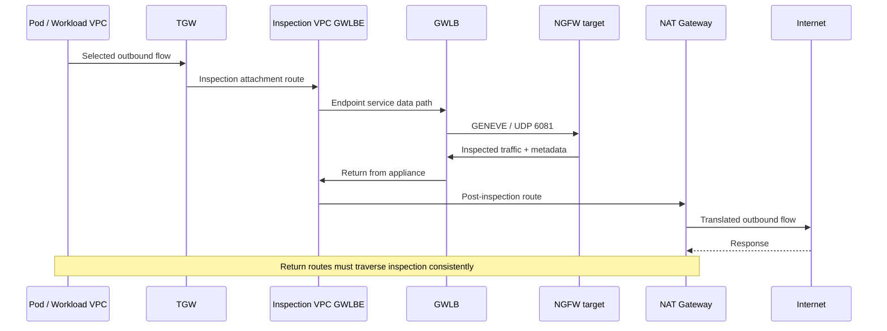

# GWLB·GENEVE: 대칭 검사 경로와 장애 검증

> **검토 기준**: AWS Gateway Load Balancer·PrivateLink·TGW·NAT 공식 문서, RFC 8926, 제조사 GWLB 통합 문서.
> **마지막 업데이트**: 2026년 10월 15일

GWLB(Gateway Load Balancer)는 원래 IP 흐름을 GENEVE 호환 보안 장비에 분배하는 서비스입니다. GWLBE(Gateway Load Balancer endpoint)는 소비 VPC의 route target이며, 보안 정책 자체는 장비에 있습니다. 이 장은 [Palo Alto·Fortinet](./15-ngfw-paloalto-fortinet.md) 선택 이후 실제 검사 경로·세션·장애를 검증하기 위한 가이드입니다. Route 표와 수용 기준은 설계 예시이며 완성된 IaC나 실제 배포 결과가 아닙니다. [S24] [S27]

## 1. 구성 요소와 책임

| 구성 요소 | 역할 | 확인할 점 |
|---|---|---|
| GWLB | IP flow를 target에 전달 | AZ, target group, stickiness·failover |
| GENEVE target group | 장비 등록과 health·속성 | GENEVE port 6081, 지원 IP target·instance target |
| Appliance | 해제·검사·재캡슐화 | 정책·세션·라이선스·metadata·MTU |
| Endpoint service | 공급 GWLB를 소비 VPC에 노출 | allowed principals·acceptance·소유 계정 |
| GWLBE | 소비 VPC의 zonal route target | subnet·AZ·endpoint 상태·route |
| TGW appliance mode | flow별 inspection attachment ENI/AZ를 양방향에 일관되게 선택 | 검사 VPC attachment에 적용한 실제 상태 |

Endpoint service의 principals·연결 acceptance는 연결 생성의 경계이고, 세션의 앱 인가나 장비 정책을 대신하지 않습니다. 서로 다른 계정의 AZ 이름 문자열보다 **AZ ID**로 물리적 AZ를 대조합니다. GWLB endpoint의 생성·제약은 [PrivateLink 가이드][S27]를 확인합니다.

GWLB에는 ALB식 security group을 붙이지 않습니다. **GWLBE도 SG를 지원하지 않습니다.** ELB API의 SG는 ALB/NLB에, VPC endpoint API의 SG는 interface endpoint에 해당합니다. 장비·워크로드 ENI의 SG, NACL, 실제 route와 장비 정책을 검토합니다. [S39] [S40]

## 2. GENEVE는 검사 transport이며 암호화가 아니다

```text
Outer IP
  └─ UDP destination port 6081
      └─ GENEVE header + options / AWS metadata
          └─ Original encapsulated traffic
```

RFC 8926은 GENEVE header·VNI·가변 option과 UDP transport를 정의합니다. AWS GWLB는 Option Class `0x0108`의 TLV metadata를 사용하며, 장비는 TLV 쌍을 처리하고 GWLB는 이 metadata로 반환 GWLBE를 선택합니다. 지원 integration에서 필요한 metadata를 보존합니다. “일반 GENEVE를 지원한다”만으로 GWLB 호환성을 입증하지 않습니다. [S31] [S42] [S29]

GENEVE는 TLS·IPsec처럼 payload를 암호화하지 않습니다. 동일 포트라도 Cilium overlay와 GWLB encapsulation은 목적·처리 경로가 다릅니다. TLS payload 검사는 장비의 별도 복호화 정책 또는 종료 지점의 통제가 필요합니다. [S31] [S24]

## 3. AZ별 egress 논리 흐름

아래는 중앙 egress의 **한 방향 논리 흐름**입니다. 실제 TGW·GWLBE·장비·NAT는 AZ별로 선택되며 응답은 같은 세션의 일관된 검사 경로로 돌아와야 합니다.



TGW attachment subnet, endpoint subnet와 NAT subnet의 route table이 서로 다른 역할을 맡습니다. “모든 subnet의 `0.0.0.0/0`을 GWLBE”로 바꾸면 검사 후 트래픽이 다시 GWLBE로 들어가 loop가 생길 수 있습니다. AWS의 TGW 검사와 NAT 결합 가이드를 함께 검토합니다. [S29] [S30]

## 4. 중앙 검사 route 검토 표

다음 표는 중앙 IPv4 egress와 VPC 간 검사에 대한 한 가지 패턴입니다. 실제 CIDR·AZ·endpoint·attachment ID, prefix 우선순위와 existing route를 확인한 뒤 설계합니다. “소비 VPC”가 곧 “모든 방향 검사”를 뜻하지 않습니다.

| 위치 | 선택한 목적지 | 예시 next hop / 확인 목적 |
|---|---|---|
| Spoke workload subnet | 다른 spoke CIDR, 외부 default | TGW |
| Spoke가 연결된 TGW route table | 검사 대상 spoke/외부 | Inspection VPC attachment |
| Inspection VPC의 TGW attachment subnet | 검사 대상 목적지 | 해당 AZ의 GWLBE |
| GWLBE subnet | spoke CIDR | TGW |
| GWLBE subnet | 외부 `0.0.0.0/0` | 해당 AZ NAT Gateway |
| NAT subnet | 외부 `0.0.0.0/0` | Internet Gateway |
| NAT subnet | 반환할 spoke CIDR | 검사 GWLBE |
| Inspection attachment가 연결된 TGW route table | spoke CIDR | 해당 spoke attachment; 다시 검사 attachment로 보내지 않음 |

요청은 검사 후 NAT로, 응답은 NAT의 역변환 후 검사를 거쳐 TGW로 돌아오는 구조입니다. NAT subnet의 return route를 빠뜨리면 요청만 검사하거나 stateful 세션이 끊길 수 있습니다. NAT 위치를 다른 곳으로 변경하면 tuple·route 설계도 다시 검토합니다. [S29] [S30]

중앙 검사 attachment에서 TGW appliance mode를 확인합니다. 이는 flow별 inspection attachment ENI/AZ를 양방향에 일관되게 선택하며, TGW의 기본 origin-AZ 선호를 대신해 cross-AZ 라우팅을 허용합니다. 같은 firewall instance의 세션 복제까지 제공하지 않습니다. GWLB target 선택과 별도로 검증합니다. [S29] [S25] [S32]

### Internet ingress는 별도의 설계다

인터넷 ingress 삽입에는 Internet Gateway edge-associated route table, 보호 subnet route, GWLBE subnet route와 return path를 함께 설계해야 합니다. ALB·IGW·GWLBE를 순서 없이 나열한 그림은 충분하지 않습니다. AWS 문서는 IGW/VGW를 대상으로 한 gateway route table의 제약을 설명합니다. ALB의 proxy front/backend 연결도 각각의 flow로 추적합니다. [S28]

## 5. 중앙 경로 밖의 트래픽

| 경로 | 왜 별도 검증하는가 | 보완 기준 제안 |
|---|---|---|
| 같은 노드의 Pod 통신 | VPC/TGW까지 나오지 않을 수 있음 | CNI·NetworkPolicy·서비스 인가 |
| VPC local·다른 subnet | default route보다 구체적인 local route | 지원되는 local route 설계 또는 CNI·SG |
| Peering·별도 TGW attachment | 중앙 검사 route와 다를 수 있음 | 실제 effective route와 연결 목록 |
| PrivateLink·gateway endpoint | public egress default와 다른 경로 | IAM·endpoint/resource policy·앱 인가 |
| IPv6·NAT64·proxy | IPv4 `0.0.0.0/0`만으로 포괄 불가 | 각 서비스·장비의 지원과 `::/0` 경로 |
| 관리·health check | 데이터 검사와 목적이 다름 | 제한된 관리/health 소스와 기록 |

VPC local route는 제한된 조건에서 appliance로 재지정할 수 있지만, “불가능”이나 “자동으로 중앙화”라고 일반화하지 않습니다. 현재 route 유형·지원 target·CIDR 제약을 확인합니다. [S28]

EKS에서는 Pod/노드 IP·CNI SNAT·Security Groups for Pods 모드가 관측과 경로에 영향을 줍니다. Pod 정책과 VPC 검사 route를 한 설정으로 취급하지 않습니다. [S33] [S34] [S44]

## 6. Stickiness와 idle timeout

기본 GWLB stickiness는 source/destination IP, source/destination port와 protocol의 **5-tuple**입니다. 지원 설정으로 **3-tuple**(IP 쌍+protocol) 또는 **2-tuple**(IP 쌍)을 선택할 수 있지만, **TGW appliance mode를 켠 구성에는 2/3-tuple이 지원되지 않습니다.** 이 중앙 검사 패턴은 5-tuple을 사용합니다. reduced-tuple은 특정 target에 부하를 집중시킬 수 있으므로 선택 모드의 제약과 용량을 확인합니다. [S25]

TCP idle timeout 기본값은 350초이며, 5-tuple stickiness에서는 지원 범위 60–6000초로 변경할 수 있습니다. UDP idle timeout은 고정 120초입니다. 2/3-tuple에서 TCP timeout 변경을 지원한다고 가정하지 않습니다. 장비·NAT·앱·TGW와 target ENI의 `TcpEstablishedTimeout`도 독립적으로 확인합니다. GWLB timeout이 ENI timeout보다 길면 연결 추적의 불일치로 drop이 발생할 수 있습니다. [S24]

TCP timeout 후의 새 SYN은 새 flow로 처리되지만, 이전 연결의 data packet은 drop됩니다. UDP timeout 후 packet은 새 flow가 될 수 있습니다. timeout 연장과 여러 장비의 세션 상태 공유는 별개입니다. keepalive·idle 후 재개·장시간 gRPC/WebSocket·UDP를 시험합니다. [S24]

## 7. Health·failover·fail open을 정확히 구분

| 상태/설정 | AWS 문서의 동작 | 운영에서 검증할 점 |
|---|---|---|
| 하나의 target unhealthy | 새 flow는 사용 가능한 healthy target 선택 | 기존 flow의 configured failover |
| `target_failover.on_unhealthy=no_rebalance` | 기존 flow의 target 유지 | unhealthy target에서 blackhole 가능 |
| `target_failover.on_unhealthy=rebalance` | 기존 flow를 다른 target에 재분배 | 독립 장비에서 세션 유실 가능 |
| deregistration failover | `on_deregistration`에 따라 처리 | drain·scale-in·upgrade |
| 모든 target unhealthy | flow별 unhealthy target을 임의 선택해 reset/timeout까지 유지; AWS는 해당 target이 healthy가 될 때까지 drop된다고 설명 | 문서상 결과 검증; health만 실패했는데 전달되는 경우는 PoC 가설 |
| 등록된 target 없음 | 새 flow의 전달 대상 없음; drop 검증 | empty fleet 알림·복구, 기존 draining flow 구분 |

`target_failover.on_unhealthy`와 `target_failover.on_deregistration`은 같은 값으로 설정해야 합니다. `no_rebalance`가 기본값입니다. Health check는 TCP·HTTP·HTTPS를 지원하고 실제 protocol·port·path를 장비와 맞춰야 합니다. [S25] [S26]

현재 AWS 문서는 `send_tcp_reset.on_unhealthy.enabled`와 `send_tcp_reset.on_deregistration.enabled`도 제공합니다. 기본값은 `false`이며, TCP에만 적용하고 5-tuple(`stickiness.enabled=false`)과 `no_rebalance`가 필요합니다. `rebalance` 또는 reduced-tuple과 함께 켤 수 없습니다. RST를 받은 client의 재연결·재시도·업무 중복 처리를 시험하며, 이를 무중단 세션 이전으로 설명하지 않습니다. deregistration의 drain 시간도 확인합니다. [S25]

**모든 target이 unhealthy일 때 GWLB가 장비를 직접 우회하지는 않습니다.** AWS는 flow별 target 임의 선택과, 선택된 target이 healthy가 될 때까지 traffic drop을 설명합니다. 결정은 AZ별로 독립적이며 cross-zone을 끈 경우 각 AZ의 대상 집합을 확인합니다. cross-zone은 선택 가능한 대상을 넓히며 기존/신규 flow의 동작 구분은 그대로 필요합니다. [S26]

과거 배치 블로그의 “fail-open mode”는 기존 flow가 실패한 target을 유지하는 문맥입니다. 이를 가용성 보장이나 직접 우회 기능으로 해석하지 않고 장비 자체의 fail-open과도 구분합니다. health만 실패했는데 전달되는 경우는 실험할 가설이며 문서가 보장하는 복구 동작이 아닙니다. [S32] [S25] [S26]

Cross-zone load balancing은 남은 AZ의 healthy target을 사용할 선택지를 제공하지만 state 복제·zonal endpoint 복구를 제공하지 않습니다. cross-AZ 비용·용량·session disruption과 함께 검토하고, GWLBE 또는 AZ 손실을 target 손실과 별도로 시험합니다. 과거 배치 블로그의 “GWLB는 RST를 보내지 않는다”는 설명보다 현재 target group 속성 문서를 우선합니다. [S24] [S25] [S27] [S32]

## 8. MTU·fragment·NACL·health 경로

AWS는 GWLB의 최대 packet 크기를 8500 bytes로 설명하고, GENEVE가 68 bytes를 추가한다고 안내합니다. GWLB는 fragmentation이나 Path MTU Discovery를 대신하지 않습니다. 큰 workload MTU가 TGW·NAT·장비까지 모두 통과한다는 뜻은 아닙니다. [S24] [S32]

검토할 항목:

- 실제 전체 경로의 MTU, 장비 GENEVE interface의 여유, TCP MSS 처리.
- 큰 packet·UDP datagram·TLS/HTTP2·업로드·fragment의 처리 결과.
- 외부 UDP 6081과 내부 payload protocol을 구분한 SG·NACL·장비 정책.
- TCP/HTTP/HTTPS health port의 도달성·응답과 실제 검사 canary.
- stateless NACL의 request·return port와 실제 outer tuple.
- IPv6 지원·encapsulation·ICMP/ICMPv6 필요 조건을 현재 제품별로 확인.

포트가 열린 사실이나 `healthy` 상태 하나로 정상 검사를 입증하지 않습니다. [S26] [S32]

## 9. 승인된 환경에서 수행할 읽기 전용 점검

아래는 AWS CLI 읽기 전용 명령 예시입니다. Region과 실제 소유 리소스 ID를 명시하며 shell 변수에는 조사 대상을 직접 설정합니다. 이번 조사에서는 실행하지 않았습니다.

```bash
aws elbv2 describe-load-balancer-attributes \
  --region "$INSPECTION_REGION" --load-balancer-arn "$INSPECTION_GWLB_ARN"

aws elbv2 describe-target-group-attributes \
  --region "$INSPECTION_REGION" --target-group-arn "$INSPECTION_TARGET_GROUP_ARN"

aws elbv2 describe-target-health \
  --region "$INSPECTION_REGION" --target-group-arn "$INSPECTION_TARGET_GROUP_ARN"

aws ec2 describe-vpc-endpoints \
  --region "$INSPECTION_REGION" --vpc-endpoint-ids "$INSPECTION_ENDPOINT_ID"

aws ec2 describe-route-tables \
  --region "$INSPECTION_REGION" --route-table-ids "$INSPECTION_ROUTE_TABLE_ID"

aws ec2 describe-transit-gateway-vpc-attachments \
  --region "$INSPECTION_REGION" \
  --transit-gateway-attachment-ids "$INSPECTION_TGW_ATTACHMENT_ID"
```

로드 밸런서 속성의 cross-zone, target group의 stickiness·failover, target health, endpoint state·AZ, route·association, attachment의 `ApplianceModeSupport`를 비교합니다. TGW route table association·propagation·effective route는 별도 조회해야 하며, 위 여섯 명령만으로 대칭성을 증명하지 않습니다.

## 10. 장애 실험과 수용 기준

다음은 격리된 승인 환경에서 수행할 검증 계획입니다.

| 실험 | 반드시 기록할 결과 |
|---|---|
| 정상 허용·거부 canary | request/response 5-tuple, target, 정책/profile, 앱 결과 |
| 한 target health 실패 | 기존/신규 세션, `no_rebalance`·`rebalance` 차이 |
| 모든 target unhealthy | 실제 unhealthy 전달, 검사 여부·오류; 직접 우회로 오해하지 않음 |
| fleet 비움 | 새 flow drop·기존 drain 구분·알림·복구 |
| TCP RST 기능 | 5-tuple·no_rebalance 제약, client 재연결·재시도 |
| AZ·endpoint 경로 손실 | endpoint와 target 장애 차이, failover·복구 |
| scale-in·rolling upgrade | drain, 세션 끊김, 등록 준비·정책 일관성 |
| NAT·route 변경 | 변환 전후 tuple, return path·loop |
| MTU·idle·IPv6 | 큰 packet·장시간 세션·지원 경로별 결과 |
| 중앙 경로 밖 통신 | local·endpoint·peering·Pod 경로와 보완 통제 |

수용 기준은 **정상 업무 SLO, 실제 검사·차단 증거, 기존/신규 세션 동작, N-1 용량, 우회 경로 설명, rollback·복구 담당자**를 함께 포함하도록 제안합니다. 이번 문서 보강은 실환경 배포·장애 주입·성능 측정을 수행하지 않았습니다.

## 다음 학습

- [Palo Alto·Fortinet NGFW](./15-ngfw-paloalto-fortinet.md)
- [WAF·origin 보호](./14-waf-edge-api-security.md)
- [사고 기반 다층 방어](./13-defense-in-depth-incident-response.md)
- [이 장의 퀴즈](../quizzes/security/16-gwlb-geneve-inspection-quiz.md)

## 참고 자료와 조사 기준

아래 공식 자료는 2026-10-15에 조회했습니다. 변경 시 해당 제품·브랜치의 최신 경보와 제약을 다시 확인합니다.

- [S24: AWS: Gateway Load Balancers][S24]
- [S25: AWS GWLB: Target group attributes][S25]
- [S26: AWS GWLB: Health checks][S26]
- [S27: AWS PrivateLink: Gateway Load Balancer endpoints][S27]
- [S28: AWS VPC: Route table options][S28]
- [S29: AWS: Centralized inspection with GWLB and TGW][S29]
- [S30: AWS: NAT Gateway scenarios][S30]
- [S31: RFC 8926: GENEVE][S31]
- [S32: AWS: GWLB deployment best practices][S32]
- [S33: EKS: Network security][S33]
- [S34: Kubernetes: Network Policies][S34]
- [S39: AWS ELB API: CreateLoadBalancer parameters][S39]
- [S40: AWS EC2 API: CreateVpcEndpoint parameters][S40]
- [S42: AWS GWLB: Target groups][S42]
- [S44: EKS: Outbound internet access and SNAT][S44]

[S24]: https://docs.aws.amazon.com/elasticloadbalancing/latest/gateway/gateway-load-balancers.html
[S25]: https://docs.aws.amazon.com/elasticloadbalancing/latest/gateway/edit-target-group-attributes.html
[S26]: https://docs.aws.amazon.com/elasticloadbalancing/latest/gateway/health-checks.html
[S27]: https://docs.aws.amazon.com/vpc/latest/privatelink/gateway-load-balancer-endpoints.html
[S28]: https://docs.aws.amazon.com/vpc/latest/userguide/route-table-options.html
[S29]: https://aws.amazon.com/blogs/networking-and-content-delivery/centralized-inspection-architecture-with-aws-gateway-load-balancer-and-aws-transit-gateway/
[S30]: https://docs.aws.amazon.com/vpc/latest/userguide/nat-gateway-scenarios.html
[S31]: https://www.rfc-editor.org/info/rfc8926/
[S32]: https://aws.amazon.com/blogs/networking-and-content-delivery/best-practices-for-deploying-gateway-load-balancer/
[S33]: https://docs.aws.amazon.com/eks/latest/best-practices/network-security.html
[S34]: https://kubernetes.io/docs/concepts/services-networking/network-policies/
[S39]: https://docs.aws.amazon.com/elasticloadbalancing/latest/APIReference/API_CreateLoadBalancer.html
[S40]: https://docs.aws.amazon.com/AWSEC2/latest/APIReference/API_CreateVpcEndpoint.html
[S42]: https://docs.aws.amazon.com/elasticloadbalancing/latest/gateway/target-groups.html
[S44]: https://docs.aws.amazon.com/eks/latest/userguide/external-snat.html
